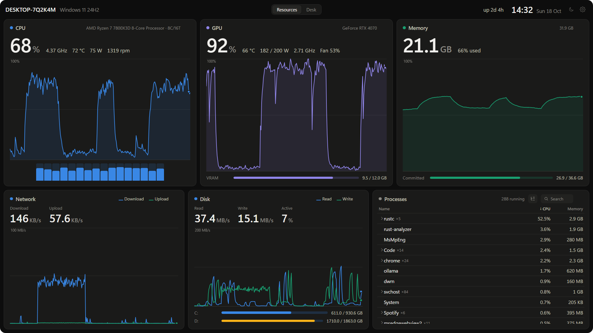
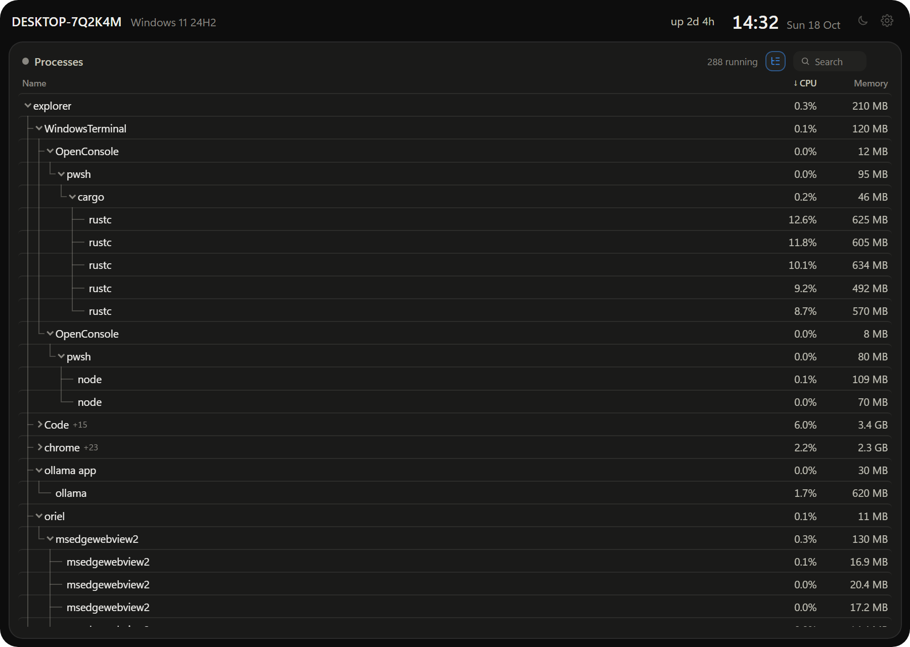
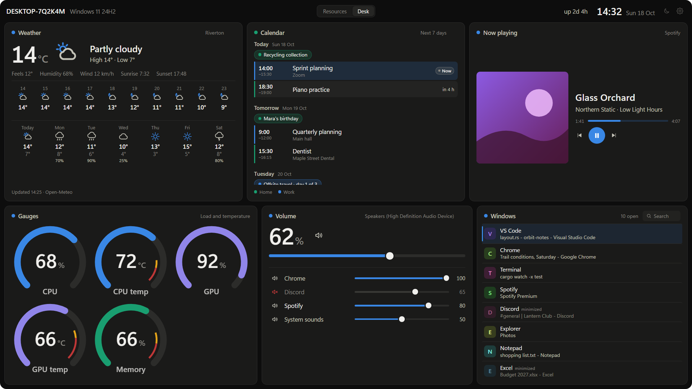
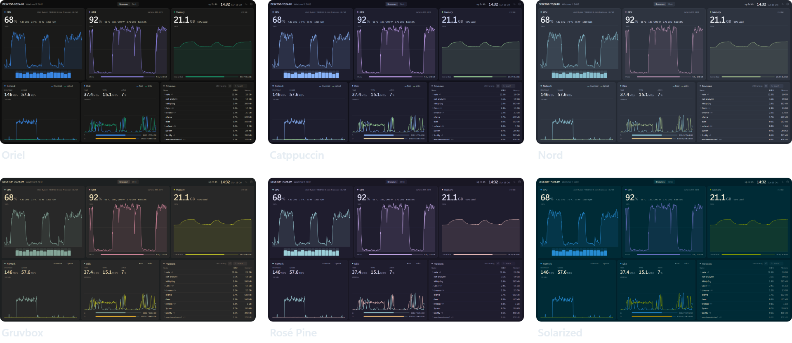
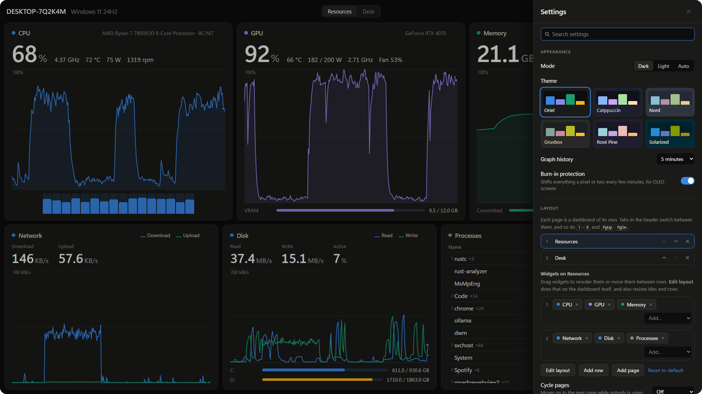

# Oriel

**A command center for your second screen, on Windows.**

Your CPU, GPU, memory, network, disks and processes, plus what's playing, the weather and your 
calendar, on one calm, full-screen dashboard you can read from across the desk and leave running all day.

[Install](#install) · [Features](#whats-on-it) · [Themes](#themes) · [Plugins](#plugins) · [FAQ](#faq) · [Contributing](CONTRIBUTING.md)

<picture>
  <source media="(prefers-color-scheme: light)" srcset="docs/images/dashboard-light.png">
  
</picture>

macOS and Linux desktops make it easy to keep an eye on your machine. Windows
gives you Task Manager, a window you open when something's already wrong.
Oriel is a dashboard for the monitor you don't otherwise use: a few big
numbers and calm graphs that only turn amber or red when something actually
needs your attention.

## Why Oriel

- **Made to be glanced at.** Big numbers, graphs with up to 10 minutes of history, and a layout
  that fits any screen from 720p to 4K, landscape or portrait.
- **Quiet until it matters.** Nothing changes color until a temperature, memory or a drive
  crosses a limit you set.
- **Light.** About 140 MB of memory and 6% of one CPU core with the dashboard on screen.
  No admin rights, drivers or services.
- **Private.** No account and no telemetry. Only the weather and calendar widgets go online, and
  only once you give them a place or a calendar link; [what they send](#weather-and-calendar) is
  short and spelled out.
- **One click into Windows.** Each tile's ↗ button opens the matching part of Windows: Task
  Manager from the process list, Storage settings from the disk tile, and so on.
- **Yours to change.** Drag tiles around and resize them, six themes in dark and light, and
  widgets in plain JavaScript if you want to write your own, even from a [plugin folder](#plugins).

## What's on it

Oriel starts with two pages. Move, add or remove anything on them in Settings → Layout or with
**Edit layout** (<kbd>E</kbd>), or add pages of your own.

**Resources**

- **CPU**: load (the same figure Task Manager shows), a bar per thread, effective clock,
  temperature, and with [LibreHardwareMonitor](#sensors) package power and fan speed
- **GPUs**: every GPU from any vendor, integrated ones included: load and memory, plus
  temperature, power, clocks and fan speed on NVIDIA
- **Memory**: in use, and committed memory against the page file limit
- **Network** and **disk**: throughput, how busy the disks are, and free space per drive
- **Processes**: everything running, with private memory like Task Manager. Grouped by name
  (`chrome ×24`, click to see each one) or as a tree like btop, with branches you can fold
  away. Search it (<kbd>/</kbd>), sort by any column, and right-click to end a process or a
  whole group
- **Battery**, uptime and a clock in the header

<picture>
  <source media="(prefers-color-scheme: light)" srcset="docs/images/process-tree-light.png">
  
</picture>

**Desk**

- **Weather**: now, the next hours and the next days for a place you pick, from
  [Open-Meteo](https://open-meteo.com)
- **Calendar**: the next 7 or 14 days from the calendar links (.ics) you paste in, from Google,
  Outlook, Apple or anything else that publishes one, recurring events and time zones included
- **Now playing**: the track, artist and cover from Spotify, your browser or any app that shows
  in Windows' media controls, with play/pause and skip
- **Volume mixer**: your speakers' or headphones' volume and every app's, each with a mute
  button, like Windows' own mixer
- **Gauges**: dials for CPU and GPU load and temperature and for memory, with your warn and
  critical limits marked on them
- **Open windows**: what the taskbar and Alt+Tab would list. Click one to bring it to the front,
  or press its × to ask it to close

<picture>
  <source media="(prefers-color-scheme: light)" srcset="docs/images/widgets-light.png">
  
</picture>

## Themes

Six themes, each with a dark and a light version. Pick dark, light, or Auto to follow Windows.

<picture>
  <source media="(prefers-color-scheme: light)" srcset="docs/images/themes-light.png">
  
</picture>

## Install

Oriel runs on Windows 10 and 11.

1. Download **Oriel-*version*-setup.exe** from the [latest release](../../releases/latest).
2. Run it. It installs just for you, with no admin prompt, and adds Oriel to the Start menu.
3. Start Oriel. If you have a second screen, it opens there, full screen.

Prefer not to install anything? Download **Oriel-*version*-portable.zip** instead, unzip it
into a folder of its own (not straight into Downloads) and run `oriel.exe`.

> [!IMPORTANT]
> Oriel isn't code-signed yet, so Windows doesn't know who made it:
> - **SmartScreen** may say *Windows protected your PC*. Click **More info**, then **Run anyway**.
> - **Smart App Control**, if it's on, may block Oriel: it only lets unsigned apps run when
>   Microsoft's cloud service judges them safe, and it has no "run anyway". It judges each file
>   on its own, so if it blocks the portable zip, try the installer, which has run where the
>   zip was blocked. If it blocks that too, you can
>   [build Oriel yourself](CONTRIBUTING.md#building-from-source) until it's signed.
>   Please don't turn Smart App Control off for Oriel: on most versions of Windows it can only
>   be turned back on by reinstalling Windows.
>
> Each release lists the SHA-256 of its files in `SHA256SUMS.txt`, so you can check a download
> with `Get-FileHash`.

To uninstall, go to **Settings → Apps → Installed apps → Oriel**. Tick **Delete the application
data** to also remove your settings and the sign-in entry.

## Using it

With two or more screens, Oriel opens full screen on one that isn't your main screen. With a
single screen it opens as a normal window, so it never covers the screen you're working on.
Closing the window hides it to the tray; the tray icon shows it again, and its menu has
**Quit Oriel**.

In the process list, click a group to see its processes. The button next to the search
switches between groups and the tree; in the tree, click a process to fold its branch away and
see the branch's total.

To end something, right-click it and choose **End process** (or **End all** for a group). Oriel
has your rights, not admin ones, so Windows won't let it end parts of Windows or apps running as
administrator; the header says so when that happens.

The dashboard has **pages**, each with its own widgets: *Resources* and *Desk* to start with.
Add, rename, reorder or delete them in Settings → Layout. With two or more, tabs show in the
header; click one, or press <kbd>1</kbd>–<kbd>9</kbd>
or <kbd>PgUp</kbd>/<kbd>PgDn</kbd>. Graphs keep their history on the pages you aren't looking at,
which aren't drawn until you switch to them, and Oriel opens on the page you last picked. For a
screen you don't touch, **Cycle pages** moves on to the next page every so often, and waits
while you're using the dashboard.

**Edit layout** (Settings → Layout, or <kbd>E</kbd>) changes the page you're looking at, right
on the dashboard. Drag a tile to move it: within its row, into another row, or onto the line
between rows for a row of its own. Drag the edge between two tiles to change their widths, or
the edge between two rows to change their heights. **×** removes a tile and **Add a widget**
puts one back. With the keyboard, <kbd>Tab</kbd> to a tile, then the arrow keys move it,
<kbd>Alt</kbd> + arrow keys resize it and <kbd>Delete</kbd> removes it. <kbd>Esc</kbd> or **Done**
finishes; everything saves as you go, and **Reset sizes** goes back to each widget's own size.
On a portrait or very narrow window tiles wrap or stack, so there are no edges to drag there.

| Key | |
|---|---|
| <kbd>,</kbd> | Settings |
| <kbd>E</kbd> | Edit the layout of the page on screen |
| <kbd>1</kbd>–<kbd>9</kbd>, <kbd>PgUp</kbd>/<kbd>PgDn</kbd> | Switch pages, with two or more |
| <kbd>/</kbd> or <kbd>Ctrl</kbd>+<kbd>F</kbd> | Search the process list, or the settings while they're open |
| <kbd>Esc</kbd> | Clear the search, close settings, finish editing the layout |
| <kbd>F11</kbd> | Full screen on/off |

## Settings

Everything is in the settings panel (the gear, or <kbd>,</kbd>; start typing to search it).
Changes apply and save as you make them, to `%APPDATA%\Oriel\settings.json`:

- **Appearance**: dark, light or auto, the theme, how much history the graphs show, burn-in
  protection (shifts everything by a pixel or two every few minutes, for OLED screens)
- **Layout**: which widgets show, in which rows and order, and how big each is (also from
  **Edit layout** on the dashboard); pages to add, name, reorder or delete, each with its own
  widgets; cycling through pages
- **Display**: which screen, full screen or windowed
- **System**: start at sign-in, how often to update, hardware acceleration
- **Plugins**: load widgets from the plugins folder (off by default, see [Plugins](#plugins))
- **Alerts**: when temperatures, memory and drive space count as high or critical
- **Sensors**: NVIDIA sensors on/off, LibreHardwareMonitor address
- **Weather** and **Calendar**: the place to show, °C or °F, and the calendar links

**Hardware acceleration** is off by default. Drawing a few graphs once a second doesn't need
the GPU, and without it WebView2 uses about 130 MB less memory for slightly more CPU.

## Plugins

You can add your own widgets without rebuilding Oriel. Turn on **Settings → Plugins → Load
widgets from the plugins folder**, click **Open plugins folder** (it's
`%APPDATA%\Oriel\widgets`), drop in a widget as `name.js` (with an optional `name.css` beside
it) and restart Oriel. It then shows in Settings → Layout, marked *(plugin)*. A widget that
breaks becomes an error tile with its file name and message; the rest of the dashboard carries
on. [`docs/examples/world-clock.js`](docs/examples/world-clock.js) is a small example, and
[CONTRIBUTING.md](CONTRIBUTING.md#writing-a-plugin) is the guide to writing one.

> [!WARNING]
> A plugin is code that runs inside the dashboard with the same rights as Oriel's own widgets:
> it can read everything on the dashboard and in your settings (calendar links included), end
> processes, change volume and open Windows settings. Only use plugins from people you trust, like
> browser extensions. Oriel's content security policy keeps them from loading anything from the
> internet, but that's a safety net, not a sandbox. See [SECURITY.md](SECURITY.md) for the details.

## Sensors

Most data comes from Windows' own performance counters (the same source as Task Manager), so
Oriel works without admin rights or extra drivers.

**CPU temperature** is the exception: Windows doesn't expose it to normal programs. Out of the
box Oriel shows the ACPI thermal zone (labelled `ACPI`), which on many laptops tracks the CPU
closely but isn't the real die sensor. For the real sensor, plus CPU package power and fan
speeds, run [LibreHardwareMonitor](https://github.com/LibreHardwareMonitor/LibreHardwareMonitor)
and enable **Options → Remote Web Server** (port 8085). Oriel picks it up within 30 seconds.

**Laptops with an NVIDIA GPU (Optimus).** The discrete GPU powers off when nothing is using
it, and *any* query to NVIDIA's driver wakes it up, which costs battery and heat. Many
monitors keep it awake permanently this way. Oriel checks Windows' counters first (these
don't wake it), shows the GPU as **Asleep**, and only asks the NVIDIA driver for temperature
and power while something is already using the GPU.

## Weather and calendar

These two widgets are the only parts of Oriel that go online: each only once you've given it a
place or a calendar link, and only while it's on one of your pages. Each goes to one kind of
place, and nothing else is sent:

- **Weather** asks [Open-Meteo](https://open-meteo.com) (free, no account) for the forecast about
  every 30 minutes, with the place's coordinates rounded to about a kilometre. Pick the place in
  Settings → Weather: searching for it sends Open-Meteo the words you typed, once, when you press
  Enter, and nothing is searched as you type.
- **Calendar** fetches the links you add in Settings → Calendar about every 15 minutes. Find a
  calendar's link in its sharing settings: *Secret address in iCal format* in Google Calendar,
  *Publish a calendar* in Outlook, a public calendar's link in Apple Calendar. `webcal://` links
  work too.

A calendar link is like a password: anyone who has it can read that calendar. Oriel keeps it in
your settings file and shows it only in Settings, hidden until you press *Show*, never in a log or
an error message.

Both use Windows' own secure connections (https only, with your PC's certificates and proxy
settings). If a refresh fails, say because you're offline, the tile keeps showing what it had,
marked *Out of date*, and tries again.

Recurring events (daily, weekly, monthly and yearly, with exceptions and moved or cancelled
occurrences) work in any time zone Windows knows, and times show in your PC's own. A rarer rule
(like "the 20th week of the year") shows its event once rather than guessing.

## FAQ

**Does Oriel send my data anywhere?**
Only if you set up the weather or calendar widget, and then only what
[Weather and calendar](#weather-and-calendar) lists. There's no account, telemetry or update
check. The only other connection is to LibreHardwareMonitor's web server, at the address in
Settings (your own PC by default), to read sensors.

**Does it slow my PC down?**
With the dashboard on screen it uses about 6% of one CPU core and 140 MB of memory, most of
that for the WebView2 page. While its window is hidden it draws nothing.

**Can I use it with one screen?**
Yes. It opens as a normal window there; <kbd>F11</kbd> makes it full screen.

**Why is the CPU temperature labelled ACPI?**
See [Sensors](#sensors): Windows doesn't give normal programs the real CPU sensor, and
LibreHardwareMonitor fills that gap.

**Why isn't it signed?**
Code signing needs a paid certificate and an identity check. It's planned; until then, see the
note under [Install](#install).

## Roadmap

- [x] Dashboard, widgets, settings, tray icon, six themes
- [x] Process list with search, sorting, groups and a tree
- [x] Installer and portable zip, built by GitHub Actions
- [x] End a process from the list
- [x] Now playing, with media controls
- [x] Pages: several dashboards, each with its own widgets
- [x] Volume mixer
- [x] Calendar (from an ICS link) and weather
- [x] Open windows
- [x] Drag-and-drop layout editor and gauges
- [x] Widgets from a plugin folder
- [ ] Signed releases, and winget

## Contributing

Bug reports, ideas and pull requests are welcome. [CONTRIBUTING.md](CONTRIBUTING.md) covers
building from source, how Oriel works, writing a widget and working on the dashboard without
building the Rust side.

## License

[MIT](LICENSE)

The themes other than Oriel's own are adapted from [Catppuccin](https://catppuccin.com),
[Nord](https://www.nordtheme.com), [Gruvbox](https://github.com/morhetz/gruvbox),
[Rosé Pine](https://rosepinetheme.com) and [Solarized](https://ethanschoonover.com/solarized/),
all MIT licensed.
